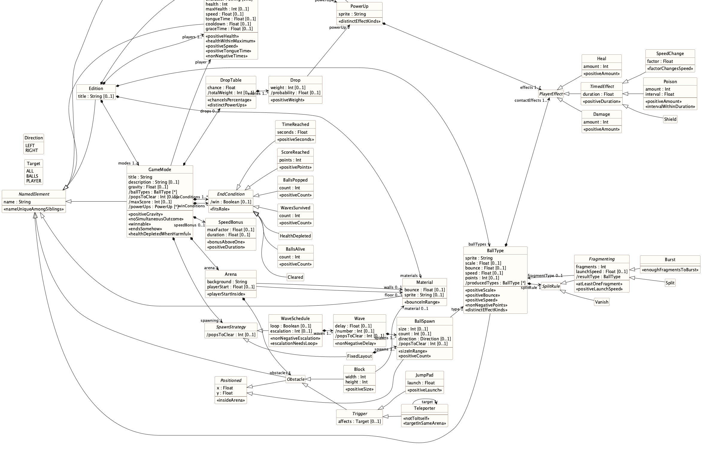

# Rango Unchained: a game mode DSL

TDT4250 final project, group 6, autumn 2026.

*Rango Unchained* is a 2D arcade game (a Bubble Trouble clone built with libGDX in TDT4240). This
project turns its **game modes** into a software product line. An *edition* of the game is
described in a small textual language. The DSL tools validate the description and generate the game
modes into the game: the rules as Java code, the arenas as level resources, and the product name into
the menus, the desktop launcher and the Android manifest.

```
edition Arcade "Rango Unchained: Arcade"

ball Mine {
	sprite "Ball/Bomb.png"
	points 30
	on pop: burst into 4 Weed
	on contact: damage 2
}

mode TimeAttack "Time Attack" {
	player Sprinter
	speed bonus up to 2 times over 60 s
	arena {
		background "Desert"
		jumppad Launcher at (25%, 0%) launch 10 affects player
	}
	waves looping escalate by 1 {
		wave { 2 * Tumbleweed size 3 at (50%, 80%) }
	}
	drops 20% { Rush weight 3, Heart }
	win when score reaches 1500
	lose when time reaches 90 s or health depleted
}
```

## Contents

| Path | What it is |
| --- | --- |
| `no.ntnu.tdt4250.rango.gamemode/` | **Metamodel.** `model/gamemode.ecore` and `.genmodel`, the EMF code in `src-gen/`, and the hand-written derived features and constraints in `src/`. |
| `no.ntnu.tdt4250.rango.gamemode.dsl/` | **Language and generator.** The Xtext grammar `RangoMode.xtext`, scoping, validation, the formatter, and the generator (Xtend templates, plus a command-line entry point). |
| `no.ntnu.tdt4250.rango.gamemode.dsl.ide/` | Generic IDE services of the language (generated by Xtext). |
| `no.ntnu.tdt4250.rango.gamemode.dsl.ui/` | **Editor.** Outline, labels and icons, hovers, content assist, templates, quick fixes, and the *Generate Game Modes into Game...* command. |
| `no.ntnu.tdt4250.rango.gamemode.tests/` | JUnit tests of the derived features and constraints of the metamodel. |
| `no.ntnu.tdt4250.rango.gamemode.dsl.tests/` | JUnit tests of the examples, validation, scoping, generator and formatter. |
| `no.ntnu.tdt4250.rango.gamemode.examples/` | **The three example editions** (`classic.rango`, `survival.rango`, `arcade.rango`). |
| `no.ntnu.tdt4250.rango.gamemode.feature/`, `.repository/`, `.target/` | Eclipse feature, p2 update site and target platform of the build. |
| `rango-game/` | **The game**, with the hand-written mode runtime and the generated game modes of the *Survival* edition. |
| `docs/` | Class diagram of the metamodel (`metamodel.png`, generated from the Ecore model via `metamodel.puml`). |
| `pom.xml`, `mvnw` | Maven/Tycho build of the plug-ins. |

## Quick start

You need JDK 21. The Maven wrapper downloads Maven, and the game's Gradle wrapper downloads Gradle.
Gradle 8.12 runs on JDK 21 to 23.

```sh
./mvnw verify                      # build the plug-ins, regenerate the language, run all tests
./mvnw verify -Pgame               # also generate the Survival edition into rango-game/ and build the game
./mvnw verify -Pgame -Dedition=arcade   # derive another product (classic, survival or arcade)
cd rango-game && ./gradlew lwjgl3:run   # play: main menu > Game Modes
```

The build also produces an update site in
`no.ntnu.tdt4250.rango.gamemode.repository/target/repository/`. You can install it into an Eclipse
2026-06 with Xtext through *Help > Install New Software... > Add... > Local...*.

### In Eclipse

1. Use *Eclipse IDE for Java and DSL Developers* or *Modeling Tools* 2026-06 with Xtext 2.43 and
   Eclipse OCL.
2. Use *File > Import > Existing Projects into Workspace* on the repository root, and select all
   projects except `rango-game`.
3. Optionally, open `no.ntnu.tdt4250.rango.gamemode.target/*.target` and choose *Set as Active
   Target Platform*.
4. Launch a runtime Eclipse: *Run As > Eclipse Application* on `no.ntnu.tdt4250.rango.gamemode.dsl.ui`.
   Then import `no.ntnu.tdt4250.rango.gamemode.examples` into the runtime workspace and open a
   `.rango` file.
5. On every save, the Xtext builder writes a preview of the generated files to the `generated-game/`
   folder next to the models. To change the game, right-click a model (or the editor) and choose
   **Generate Game Modes into Game...**, then pick the `rango-game` folder. The command validates the
   model and refuses to generate if it has errors.

To regenerate the language after changing the grammar, run `GenerateRangoMode.mwe2` (*Run As > MWE2
Workflow*). The Maven build does this on every run. To regenerate the model code after changing the
Ecore model, use *Generate Model Code* on `gamemode.genmodel`. The hand-written code is marked
`@generated NOT` and is kept.

### From the command line

```sh
java -cp <dsl classpath> no.ntnu.tdt4250.rango.gamemode.dsl.generator.Main <edition.rango> <game folder>
```

This validates the model, prints its issues, and exits with 1 without generating anything if there are
errors. `-Pgame` runs the same entry point.

## The variability aspect

In the original game, a "mode" only chose which JSON level to load. How balls split, what they do to
the player, what drops, and when a round is won or lost were all hard-coded. This project models
exactly that. Following the feedback on our draft, the building blocks are *library elements with
behaviour*, not enumerations of the balls we happen to have. A ball type is defined by its tuning, by
the split rule it owns, and by the effects it has on contact. "Cactus", "Bomb" or "Bubble" are just
instances. Everything in the model is implemented in the game, and the examples show it working.

Out of scope: sound, animation, rendering, the tutorial and multiplayer, and the campaign levels (they
keep working as before).

## The metamodel



An **Edition** (the root, one product) contains reusable building blocks and the game modes made from
them:

- **BallType**: sprite, scale, bounce, speed and points. It *contains* one **SplitRule** and one or
  more **PlayerEffect**s (what it does on contact).
  - SplitRule is one of **Vanish**, or the abstract **Fragmenting** (fragments, launch speed, an
    optional *reference* to the fragment type), which is either **Split** (fan out sideways) or
    **Burst** (all directions). A Bomb that bursts into Tumbleweeds is a cross-reference between ball
    types.
- **PlayerEffect** is shared by ball contacts and power-ups: **Damage**, **Heal**, and the abstract
  **TimedEffect** (duration), which is **Shield**, **SpeedChange** or **Poison** (damage over time).
- **PowerUp**: sprite and the effects it gives. **Material**: bounce factor and texture. **PlayerProfile**:
  health, max health, speed, tongue time, shot cooldown and grace time.
- **GameMode** *references* a player profile, and *contains* an **Arena**, a **SpawnStrategy**, an
  optional **SpeedBonus**, an optional **DropTable**, and its win and lose conditions. Its ball types
  are not written down: they are derived from what it spawns.
  - Each pop is worth the points of its ball type. A **SpeedBonus** makes early pops worth up to
    `maxFactor` times as much, falling to plain points over `duration` seconds.
  - The **Arena** has a background, floor and wall materials, and **Obstacle**s: a **Block** (size,
    material) or a **Trigger**. A trigger is a **JumpPad** or a **Teleporter**, which references its
    target teleporter. Obstacles and spawns share the abstract **Positioned** (x, y in percent of the
    arena).
  - The **SpawnStrategy** is either a **FixedLayout** of **BallSpawn**s, or a **WaveSchedule** of
    **Wave**s (delay, spawns), which can loop and grow by `escalation` balls per round.
  - The **DropTable** has a chance and contains weighted **Drop**s, each of which references a power-up.
  - **EndCondition** is one of **Cleared**, **TimeReached**, **ScoreReached**, **BallsPopped**,
    **WavesSurvived**, **HealthDepleted** or **BallsAlive**. The same class can be a win or a lose
    condition. For example, TimeReached is "survive 60 s" as a win and a time limit as a loss. The
    role comes from the containing list (`winConditions`, `loseConditions`).

### Derived features (Java, in `GamemodeDerivations`)

| Feature | Meaning |
| --- | --- |
| `BallType.producedTypes`, `Fragmenting.resultType` | What popping a ball creates (the fragment type defaults to the ball's own type). |
| `GameMode.ballTypes` | The ball types of a mode: those it spawns, and everything popping them can produce (recursively). |
| `BallSpawn/Wave/SpawnStrategy/GameMode.popsToClear` | Tongue hits needed to clear everything. Recursive over split rules and fragment types; -1 for looping waves. |
| `GameMode.maxScore` | Points for clearing everything. |
| `GameMode.powerUps` | The power-ups of the mode's drop table. |
| `DropTable.totalWeight`, `Drop.probability` | The chance that a single pop drops a given power-up. |
| `Wave.number`, `EndCondition.win` | Position of a wave; the role of a condition. |

The generator, the hovers and the constraints all use these features.

### Constraints

Simple invariants are written in **OCL**, in the Ecore model, and evaluated by Eclipse OCL's
delegates. Standalone code registers the delegates through `GamemodeOCL.initialize()`. Examples:
`positiveScale`, `enoughFragmentsToBurst` (a burst has at least 3 fragments), `intervalWithinDuration`
(poison ticks within its duration), `insideArena`, `healthWithinMaximum`, `escalationNeedsLoop`,
`distinctPowerUps` (`entries->isUnique(powerUp)`), `notToItself` (teleporters), `bounceInRange`, `bonusAboveOne` (a speed bonus is worth more than plain points).

Rules that span several objects are in **Java** (`GamemodeConstraints`). They have stable diagnostic
codes, which the quick fixes use:

| Constraint | Rule |
| --- | --- |
| `nameUniqueAmongSiblings` | No two elements of a list share a name. |
| `distinctEffectKinds` | A ball type or power-up has at most one effect of each kind. |
| `noSimultaneousOutcome` | A round cannot be won and lost by the same event (survive 60 s vs. a 60 s time limit), nor start already lost (`BallsAlive` at or below the starting number of balls). |
| `winnable` | Every win condition can be met: no "all balls cleared" with looping waves, no "8 waves survived" with 5 non-looping waves, no more pops or points than the mode can give. |
| `endsSomehow` | A mode without win conditions must loop its waves. |
| `healthDepletedWhenHarmful` | If anything can hurt the player, the mode is lost when health runs out. |
| `fitsRole` | Health depleted and balls alive can only lose a round; the other conditions can only win it. |
| `targetInSameArena` | A teleporter leads to a teleporter of the same arena. |

## Concrete syntax and editor

The grammar (`RangoMode.xtext`) imports the hand-made metamodel instead of inferring one, so all
constraints and derived features apply to models written in the editor. It is customized to read like
a description of the game. Tuning can be written in any order (unordered groups). The syntax has
units (`8 s`, `25%`), positions (`at (30%, 45%)`), counts (`2 * Tumbleweed size 3`), and readable end
conditions (`win when 20 balls popped or all balls cleared`).

The editor adds:

- **Validation**: the OCL and Java constraints of the metamodel, plus warnings for unused building
  blocks, sprite paths that are not images, and duplicate titles, and a note on endless modes.
- **Scoping**: a teleporter can only target another teleporter of its own arena.
- **Quick fixes**: make a mode end (win when cleared, or loop the waves), add "lose when health depleted", move a condition to the other
  list, remove an unused element, fix sprite and background paths.
- **Hovers** that show the derived facts: the ball types of a mode, pops to clear, maximum score, drop
  probabilities, what a ball breaks into, and shots per second.
- **Outline** with icons and summaries ("Mine: bursts into 4 Weed", "win when score reaches 1500").
- **Content assist** for the images the game ships and for ball sizes, and **templates** for ball
  types, power-ups, materials, players, modes, waves and teleporter pairs.
- **Formatter** (*Source > Format*), and the **Generate Game Modes into Game...** command.

## Generation: from model to game

`RangoModeGenerator` (Xtend) writes into the game's own folder layout:

| Generated file | Content |
| --- | --- |
| `core/src/generated/java/.../Modes/Generated/<Mode>Mode.java` | One class per mode, extending the runtime's `GameModeDefinition`. Split rules become `split`/`burst` calls, effects become calls on the player, drop tables become weighted rolls (commented with the derived probabilities), waves become spawn schedules with escalation, materials become bounce factors, triggers become arena-building calls, and end conditions become the boolean expressions of `isWon` and `isLost`. |
| `assets/modes/<Mode>.json` | The arena in the game's existing level format: background, player (with the profile's health), walls, floor and roof with their materials and textures, blocks, and the balls of a fixed layout. Positions are relative to the arena. |
| `core/src/generated/java/.../Modes/Generated/GeneratedEdition.java` | The product name and the modes in menu order, read by the main menu, the mode menu and the desktop launcher's window title. |
| `android/res/values/edition.xml` | The product name for the Android launcher label. |

Earlier generated files are removed first, so a mode deleted from the model disappears from the game.

### The game runtime (hand-written, `rango-game/core/.../Modes/`)

The generated classes plug into a small runtime added to the game:

- `GameModeDefinition` is the contract.
- `ModeSession` runs a round: the wave scheduler, timed effects (shield, speed, poison), grace time,
  teleports, and the statistics the end conditions check.
- `ModeContactRules` replaces the campaign's fixed contact strategies when a mode is played.

Hooks in the existing code are kept small:

- Factories read ball kinds, materials, sprites, player speed, tongue time and cooldown from the mode.
- The physics system applies ball bounce and floor materials.
- The level loader accepts arena-relative positions.
- There is a *Game Modes* menu.

Campaign levels, the tutorial and multiplayer are unchanged.

## The three example editions

| Edition | Product | What it shows |
| --- | --- | --- |
| `classic.rango` | *Rango Unchained*, one mode | The minimal valid configuration (the draft's baseline): one ball type that splits in two, a fixed layout, won when cleared, lost on health. Only mandatory features. |
| `survival.rango` | *Rango Unchained: Survival*, two modes | **Endless Survival**: four ball types (a Bomb that *bursts into Tumbleweeds*, a Cactus that *poisons*), looping waves that grow every round, ice and grass materials, a jump pad, teleporters for balls, three power-ups, and lost when overrun by 25 balls. **Wave Rush**: five waves to survive, higher gravity. |
| `arcade.rango` | *Rango Unchained: Arcade*, three modes | Two player profiles (fast and fragile vs. slow and tough). **Time Attack**: score with a speed bonus under a time limit. **Pop Frenzy**: harmless Bubbles that *vanish* but slow you down, low gravity, a trap power-up. **Survivor**: survive 60 s in an arena split by a pillar, crossing it through player teleporters. |

The tests check that all three are valid and that together they use every concrete class, every
feature and every enumeration literal of the metamodel.

## Tests

`./mvnw verify` runs:

- `no.ntnu.tdt4250.rango.gamemode.tests`: every derived feature, each OCL invariant tested above,
  and each Java constraint. Every test breaks one rule of a valid fixture and checks that exactly that
  rule fires.
- `no.ntnu.tdt4250.rango.gamemode.dsl.tests`: the examples (validity and metamodel coverage),
  constraint and DSL errors in the editor with their issue codes, scoping of teleporters, the
  generated files and their content, and the formatter.

## Building blocks of the build

- The target platform is Eclipse 2026-06: EMF, Eclipse OCL, Xtext 2.43 and JUnit 6.
- The language module runs the MWE2 workflow in `generate-sources`, which regenerates `src-gen/`
  of `.dsl`, `.ide`, `.ui` and `.tests` from the grammar. It then compiles the Xtend generator with
  `xtend-maven-plugin`.
- The game is built by its own Gradle build. The Android module is only included when an Android
  SDK is configured.
