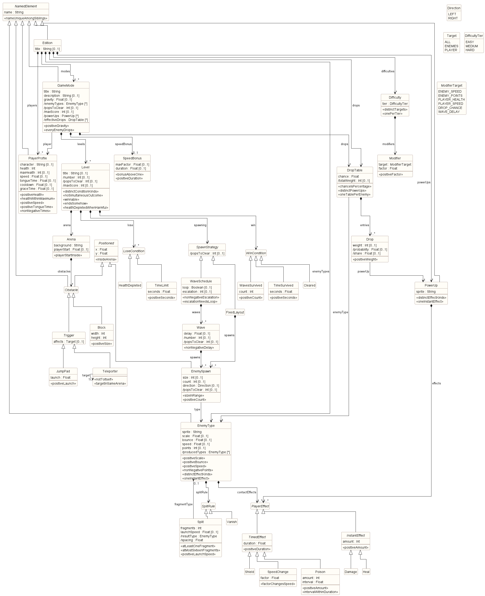

# Rango Unchained: a game mode DSL

TDT4250 final project, group 6, autumn 2026.

*Rango Unchained* is a 2D arcade game (a Bubble Trouble clone built with libGDX in TDT4240). This project introduces the variability aspect **game modes**, and makes the game into a software product line with multiple editions with different game mode configuration. An *edition* of the game is described in a small textual language. The DSL tools validate the description and generate the game
modes into the source code.

The motivation and the design choices are explained in the report,
[`docs/report/Model_Driven_Development_Rango_Unchained.pdf`](docs/report/Model_Driven_Development_Rango_Unchained.pdf). This README is the reference: how to build and
use the tools, and the details of the metamodel, the editor and the generated code.

## Contents

| Path | What it is |
| --- | --- |
| `no.ntnu.tdt4250.rango.gamemode/` | **Metamodel**: `model/gamemode.ecore` with its OCL invariants, the generated EMF code, and the hand-written derived features and Java constraints. |
| `no.ntnu.tdt4250.rango.gamemode.dsl/` | **Language and generator**: the Xtext grammar, validation, scoping, formatter and the Xtend code generator. |
| `no.ntnu.tdt4250.rango.gamemode.dsl.ide/` | Generic IDE services of the language (generated by Xtext). |
| `no.ntnu.tdt4250.rango.gamemode.dsl.ui/` | **Editor**: Eclipse editor with hovers, outline, quick fixes, content assist, templates and the *Generate Game Modes into Game...* command. |
| `no.ntnu.tdt4250.rango.gamemode.tests/` | JUnit tests of the derived features and constraints of the metamodel. |
| `no.ntnu.tdt4250.rango.gamemode.dsl.tests/` | JUnit tests of the examples, validation, scoping, generator and formatter. |
| `no.ntnu.tdt4250.rango.gamemode.examples/` | **The three example editions** (`classic.rango`, `arcade.rango`, `hardcore.rango`). |
| `no.ntnu.tdt4250.rango.gamemode.feature/`, `.repository/`, `.target/` | Eclipse feature, p2 update site and target platform of the build. |
| `rango-game/` | **The game**, with the hand-written mode runtime and the generated game modes of one edition. |
| `docs/` | Class diagram of the metamodel (`metamodel.png`, generated from the Ecore model via `metamodel.puml`), and the project report (`report/Model_Driven_Development_Rango_Unchained.pdf`, IEEE format). |
| `pom.xml`, `mvnw` | Maven/Tycho build of the plug-ins. |

## Quick start

Requires JDK 21 to 25. Xtend 2.43 fails on JDK 27, so the build stops early if `JAVA_HOME` points
to a JDK newer than 25. If it does, point it to a supported JDK for the current shell session:

```powershell
$env:JAVA_HOME = "C:\Program Files\Java\jdk-25.0.4"   # Windows PowerShell
```

```sh
export JAVA_HOME=/path/to/jdk-25                      # macOS and Linux
```

Replace the path with the location of your own JDK 21–25 installation. Then run from the
repository root:

macOS and Linux:

```sh
./mvnw package -Pgame "-Dedition=arcade"   # or classic, hardcore
cd rango-game
./gradlew lwjgl3:run
cd ..
```

Windows (Command Prompt or PowerShell):

```bat
.\mvnw package -Pgame "-Dedition=arcade"
cd rango-game
.\gradlew lwjgl3:run
cd ..
```

The first run takes a few minutes.

### Using the generator

Copy `no.ntnu.tdt4250.rango.gamemode.examples/arcade.rango` to `my-edition.rango` in the repository
root, edit it, and run the Quick start with `"-Dmodel=my-edition.rango"` instead of `"-Dedition=arcade"`.
A model with errors is not generated; the errors are printed.

`-Pgame` runs `no.ntnu.tdt4250.rango.gamemode.dsl.generator.Main <model> <game folder>` (the folder is
`rango-game` unless you set `"-Dgame.folder=<path>"`). [Generation](#generation-from-model-to-game)
lists the files it writes.

### In Eclipse

1. Import every project except `rango-game` into Eclipse 2026-06 with Xtext and OCL (*File > Import >
   Existing Projects into Workspace*). They are plain PDE and Xtext projects. Maven is only used from
   the command line, so don't import them as Maven projects.
2. Run `no.ntnu.tdt4250.rango.gamemode.dsl.ui` as an *Eclipse Application*.
3. In the new Eclipse, import `no.ntnu.tdt4250.rango.gamemode.examples` and open a `.rango` file.
4. Right-click it and choose **Generate Game Modes into Game...**, then select `rango-game`.

Saving a model in the editor also writes a preview of the generated files into a `generated-game/`
folder next to it, laid out like the game. Git ignores this folder.

To install only the editor, use the update site in
`no.ntnu.tdt4250.rango.gamemode.repository/target/repository/`.

## The metamodel



**Edition.** A model is rooted in an `Edition`: one product of the game line. It contains the
building blocks (`EnemyType`s, `PowerUp`s and `PlayerProfile`s), the edition's default drop tables,
up to one `Difficulty` per tier, and the `GameMode`s built from them.

**Enemy types and effects.** An `EnemyType` is defined by its tuning, the `SplitRule` it contains
(`Vanish` or `Split`), and the `PlayerEffect`s it has on contact. A `PowerUp` has player effects as
well, so an effect means the same in both places. A `PlayerEffect` is either an `InstantEffect`
(`Damage` or `Heal`, which share an `amount`) or a `TimedEffect` (`Shield`, `SpeedChange` or
`Poison`, which share a `duration`).

**Modes and levels.** A `GameMode` names its player profile and contains one or more `Level`s. A level
has an `Arena` (a background and `Obstacle`s: `Block`s and the `Trigger`s `JumpPad` and `Teleporter`),
a `SpawnStrategy` (a `FixedLayout` or a `WaveSchedule` that can loop and escalate) and its own end
conditions. Obstacles and enemy spawns share the abstract `Positioned`. A mode can also have a
`SpeedBonus` and its own drop tables, which replace the edition's.

**End conditions.** Each `Level` owns its win and lose conditions, so the levels of a mode can have
different goals: one level is won by clearing the arena, the next by surviving a number of seconds or
waves. A round of the
level is won or lost as soon as any of its conditions of that role holds. There is one abstract class
per role, and each kind of condition is a subclass of it:

- `WinCondition`: `Cleared`, `TimeSurvived` (seconds) and `WavesSurvived` (a count). A level has any
  number of them (`win *`); a level without any is endless.
- `LoseCondition`: `HealthDepleted` and `TimeLimit` (seconds). A level has at least one (`lose 1..*`).

Two hierarchies rather than one keep each condition in its role: "health depleted" cannot be written
as a win condition, since it is not a `WinCondition`. A condition whose kind carries a value always
has it (`[1..1]`), so whether a condition applies is shown by whether its object exists, not by a
special value.

### Derived features (Java, in `GamemodeDerivations`)

| Feature | Meaning |
| --- | --- |
| `EnemyType.producedTypes`, `Split.resultType` | What popping an enemy creates (the fragment type defaults to the enemy's own type). |
| `Split.spacing` | Degrees between neighbouring fragments: 45, or 360 over the count above eight. |
| `GameMode.enemyTypes` | The enemy types of a mode: those it spawns, and everything popping them can produce (recursively). |
| `EnemySpawn/Wave/SpawnStrategy/Level/GameMode.popsToClear` | Tongue hits needed to clear everything. Recursive over split rules and fragment types; -1 for looping waves. A mode sums its levels. |
| `Level/GameMode.maxScore` | Points for clearing everything. A mode sums its levels. |
| `Level.number` | Position of a level in its mode. |
| `GameMode.effectiveDrops` | The drop tables that apply in a mode: its own if it has any, otherwise the edition's. |
| `GameMode.powerUps` | The power-ups of the mode's effective drop tables. |
| `DropTable.totalWeight`, `Drop.share`, `Drop.probability` | How likely a power-up is when a pop drops something (`share`), and the chance that a single pop of the table's enemy type drops it (`probability`). |
| `Wave.number` | Position of a wave in its schedule. |

### Constraints

Simple invariants are written in **OCL**, in the Ecore model, and evaluated by Eclipse OCL's
delegates. Standalone code registers the delegates through `GamemodeOCL.initialize()`. Examples:
`positiveScale`, `positiveAmount` (damage, healing and poison), `atMostSixteenFragments` (a split has 1 to 16 fragments), `intervalWithinDuration`
(poison ticks within its duration), `insideArena`, `healthWithinMaximum`, `escalationNeedsLoop`,
`chanceIsPercentage` (a drop chance is above 0 and at most 100), `distinctPowerUps`
(`entries->isUnique(powerUp)`), `notToItself` (teleporters), `bonusAboveOne` (a speed bonus is worth more than plain points),
`distinctTargets` (a difficulty modifies each value at most once), `positiveFactor`,
`positiveSeconds` (the time of an end condition) and `positiveCount` (the number of enemies in a spawn, or of
waves to survive).

Rules that span several objects are in **Java** (`GamemodeConstraints`). They have stable diagnostic
codes:

| Constraint | Code | Rule |
| --- | --- | --- |
| `nameUniqueAmongSiblings` | 101 | No two elements of a list share a name. |
| `distinctEffectKinds` | 102 | An enemy type or power-up has at most one effect of each kind. |
| `oneInstantEffect` | 115 | An enemy type or power-up does not both damage and heal: they would happen at the same moment and cancel each other out. |
| `distinctConditionKinds` | 116 | A level has at most one condition of each kind per role: "time reaches 60 s or time reaches 90 s" is decided by the shorter time alone. |
| `noSimultaneousOutcome` | 105 | A level's time to survive is shorter than its time limit; otherwise the round would be lost at the same moment it is won, or before (survive 60 s vs. a 60 s time limit). |
| `winnable` | 107 | Every win condition of a level can be met: no "all enemies cleared" with looping waves, no "8 waves survived" with 5 non-looping waves or with a fixed layout. |
| `endsSomehow` | 108 | A level without a win condition must loop its waves, and must be the last level of its mode, since only winning a level unlocks the next. |
| `targetInSameArena` | 110 | A teleporter leads to a teleporter of the same arena. |
| `healthDepletedWhenHarmful` | 111 | If anything in a level can hurt the player (its enemies, or the power-ups of the mode), the level is lost when health runs out. |
| `everyEnemyDrops` | 112 | Every enemy type that can appear in a mode has a drop table there (the mode's own, or the edition's), so popping any enemy has a chance to drop a power-up. |
| `oneTablePerEnemy` | 113 | A list of drop tables (of a mode or of the edition) has at most one table per enemy type. |
| `onePerTier` | 114 | An edition defines each difficulty tier at most once. |

## Concrete syntax and editor

The grammar is `RangoMode.xtext`. Tuning can be written in any order (unordered groups). A mode gives
its rules first (player, gravity, speed bonus, drops) and then its levels. A level is an arena, its
spawning and its end conditions, which read as `win when 5 waves survived or all enemies cleared` and
`lose when health depleted or time reaches 90 s`. A mode of one level writes these directly, without a
`level { }` block. Difficulties read as the factors they apply
(`difficulty hard { enemy.speed * 1.3  player.health * 0.5 }`).

The editor adds:

- **Validation**: the OCL and Java constraints of the metamodel, plus warnings for unused building
  blocks, sprite paths that are not images, backgrounds given as a path instead of a name, duplicate
  titles, drop tables for enemies that never appear where the table applies, and a harder difficulty
  that makes something easier than the tier below it (such as slower enemies on hard than on medium),
  as well as a note on endless modes and levels. All errors come from the constraints of the
  metamodel; the DSL adds warnings and notes only.
- **Scoping**: a teleporter can only target another teleporter of its own arena.
- **Quick fixes**: make a level end (win when cleared, or loop the waves), add "lose when health depleted"
  to a level, add drop tables for the enemies without one, remove an unused element or a drop table
  without effect, fix sprite and background paths.
- **Hovers** that show the derived facts: the enemy types of a mode, pops to clear, maximum score, how
  each level is won and lost, drop probabilities, what an enemy breaks into, shots per second, and
  what each difficulty multiplies in which modes.
- **Outline** with icons and summaries ("Mine: splits into 4 Weed", "win when 6 waves survived",
  "enemy.speed ×1.3").
- **Content assist** for the images the game ships and for enemy sizes, and **templates** for enemy
  types, power-ups, players, difficulties, modes, levels, waves, teleporter pairs and drop tables.
- **Formatter** (*Source > Format*), and the **Generate Game Modes into Game...** command.

## Generation: from model to game

`RangoModeGenerator` (Xtend) writes into the game's own folder layout:

| Generated file | Content |
| --- | --- |
| `core/src/generated/java/.../Modes/Generated/<Mode>Mode.java` | One class per mode, extending the runtime's `GameModeDefinition`. Split rules become `split` calls (with the derived spacing), effects become calls on the player, each enemy type's drop table becomes a chance roll and a weighted pick inside that enemy's case of `onEnemyPopped` (commented with the derived shares and probabilities), fixed layouts become spawn calls at the start of a level and waves become spawn schedules with escalation, triggers become arena-building calls, and the end conditions of each level become the boolean expressions of `isWon` and `isLost` for that level (one check per condition class, joined by `\|\|`; levels with the same conditions share a case). |
| `assets/modes/<Mode>-<n>.json` | The arena of each level in the game's existing level format: background, player, walls, floor and roof, and blocks. Positions are relative to the arena. |
| `core/src/generated/java/.../Modes/Generated/GeneratedEdition.java` | The product name, the modes in menu order, and the difficulties from the easiest tier to the hardest, each with the factors of its modifiers (`new Difficulty("hard", "Hard").with(Difficulty.ENEMY_SPEED, 1.3f)`). Read by the main menu, the difficulty menu and the desktop launcher's window title. |
| `android/res/values/edition.xml` | The product name for the Android launcher label. |

Earlier generated files are removed first, so a mode deleted from the model disappears from the game.

### The game runtime (hand-written, `rango-game/core/.../Modes/`)

The generated classes plug into a small runtime added to the game:

- `GameModeDefinition` is the contract. Level-specific parts (arena, triggers, waves, win and lose
  checks) take the level.
- `ModeSession` runs a round, that is one level: the wave scheduler, timed effects (shield, speed, poison), grace time,
  teleports, and the statistics the end conditions check.
- `ModeContactRules` replaces the original fixed contact strategies when a mode is played.
- `ModeProgress` remembers the unlocked levels of each mode across restarts.
- `Difficulty` holds the factors of one tier (1 for a value it does not change).
  `DifficultyAdjustedMode` wraps a generated mode and multiplies its enemy speeds, player profile,
  wave delays, points and drop chances by them. The rest of the game sees an ordinary
  `GameModeDefinition`, so the generated mode classes do not depend on difficulties.

Hooks in the existing code are kept small:

- Factories read enemy kinds, sprites, player speed, tongue time and cooldown from the mode.
- The physics system applies the bounce of each enemy type and, on each floor bounce, caps its horizontal speed at
  the type's speed.
- The level loader accepts arena-relative positions. When a level starts, the level controller lets the mode build
  its triggers and place the enemies of a fixed layout through the same spawner as waves, so both are spread out the
  same way and move at their type's speed, which the difficulty's `enemy.speed` factor scales.
- The main menu lists the modes of the edition and the tutorial. If the edition has difficulties, a
  mode first opens the difficulty menu (`SelectDifficultyView`). A mode of several levels opens a
  level list (`SelectModeLevelView`), and the game over screen offers the next level once one is won.
- The player factory takes the player's health from the mode being played, so a difficulty can
  change it.

The tutorial and multiplayer are unchanged from the base game and not modelled.

## The three example editions

| Edition | Product | What it shows |
| --- | --- | --- |
| `classic.rango` | *Rango Unchained*, two modes | **Campaign**: the original game's five levels, each with its own arena (most with stone blocks), layout and *goal*, won one after the other to unlock the next: most are cleared, one against a 120 s clock, one is won by clearing it or holding out for 60 s, and the last is cleared within 45 s. **Endless**: looping waves that grow every round, two ledges, a jump pad, teleporters for enemies, no win condition, and lost only when health runs out. Four enemy types (a Bomb that *explodes into a ring of eight Tumbleweeds*, a Cactus that *poisons*) and three power-ups. Both modes use the *edition's drop tables*: the tougher the enemy, the likelier and better its drop. Three *difficulty tiers* apply to both modes: they change enemy speed, player health and drop chance (hard also gives more points), and in Endless the calm between waves. |
| `arcade.rango` | *Rango Unchained: Arcade*, five modes | Two player profiles (fast and fragile vs. slow and tough). **Time Attack**: six growing waves to survive under a time limit, with a speed bonus for early pops. **Pop Frenzy**: harmless Bubbles that *vanish* but slow you down, low gravity, a trap power-up. **Survivor**: survive 60 s in an arena split by a pillar, crossing it through player teleporters. **Wave Rush**: five waves to survive under higher gravity. **Minefield**: clear the mines in heavy gravity within 45 s. Every mode has *its own drop tables* (no edition defaults), so the same Mine mostly drops a Rush in Time Attack but can drop a trap in Minefield. |
| `hardcore.rango` | *Rango Unchained: Hardcore*, one mode | **Gauntlet**: one heart and no healing (the only power-up is a short shield), against fast enemies that split into more of themselves: a Bomb bursts into four Armadillos, an Armadillo into three, a Cactus poisons. The edition has *no difficulty tiers*, so its mode plays exactly as modelled. |

The tests check that all three are valid and that together they use every concrete class, every
feature and every enumeration literal of the metamodel.

## Tests

`./mvnw verify` runs:

- `no.ntnu.tdt4250.rango.gamemode.tests`: every derived feature, every OCL invariant of every class
  (also where several classes share a name, such as `positiveCount`), and every Java constraint. Each
  test breaks one rule of a valid fixture and checks that exactly that rule fires. The one exception
  is a level without lose conditions whose enemies hurt the player, which breaks both the lower bound
  of `Level.lose` and `healthDepletedWhenHarmful`.
- `no.ntnu.tdt4250.rango.gamemode.dsl.tests`: the examples (validity and metamodel coverage),
  constraint errors and DSL warnings in the editor with their issue codes, levels with goals of their
  own, scoping of teleporters, the generated files and their content, the formatter, and the
  serializer that quick fixes rely on.

## Building blocks of the build

- The target platform is Eclipse 2026-06: EMF, Eclipse OCL, Xtext 2.43 and JUnit 6.
- The language module runs the MWE2 workflow in `generate-sources`, which regenerates `src-gen/`
  of `.dsl`, `.ide`, `.ui` and `.tests` from the grammar. It then compiles the Xtend generator with
  `xtend-maven-plugin`.
- The game is built by its own Gradle build. The Android module is only included when an Android
  SDK is configured.
- GitHub Actions (`.github/workflows/build.yml`) runs `./mvnw verify -Pgame` for each of the three
  editions on Linux, and the same build of Arcade on Windows in the Command Prompt.
